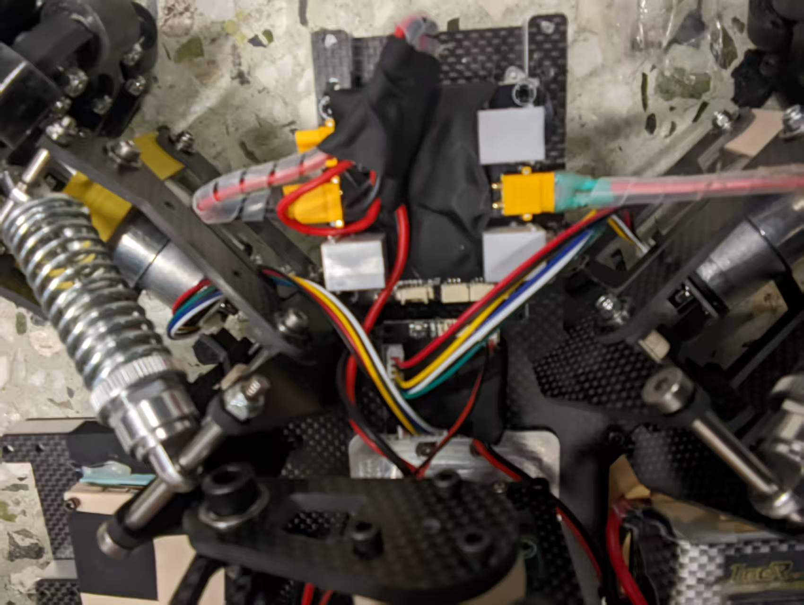
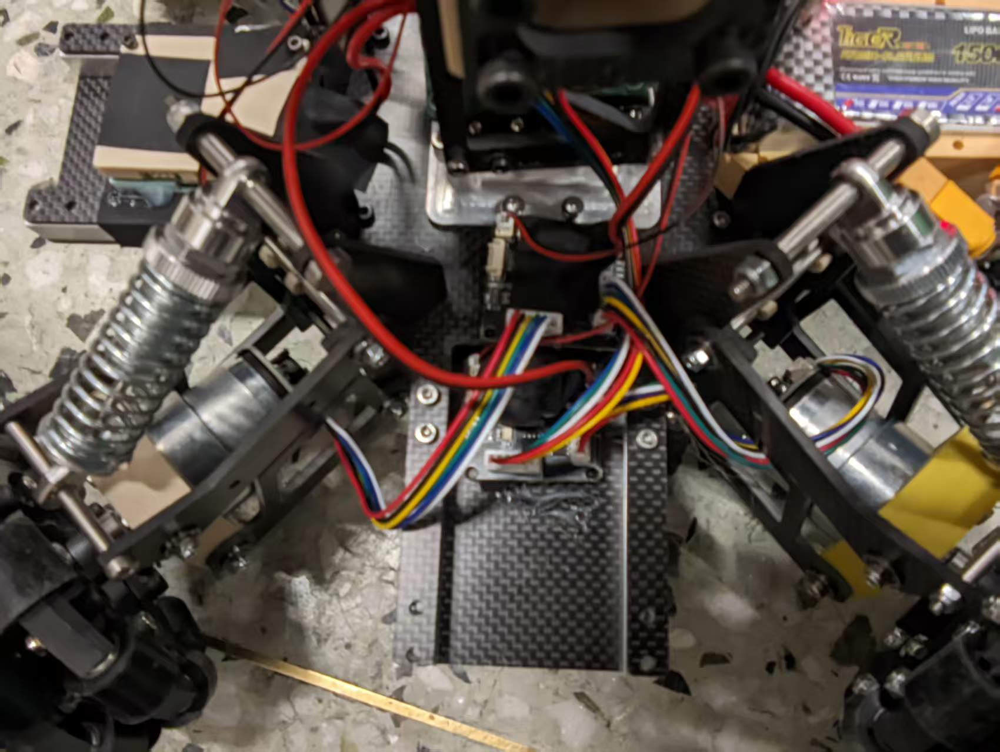
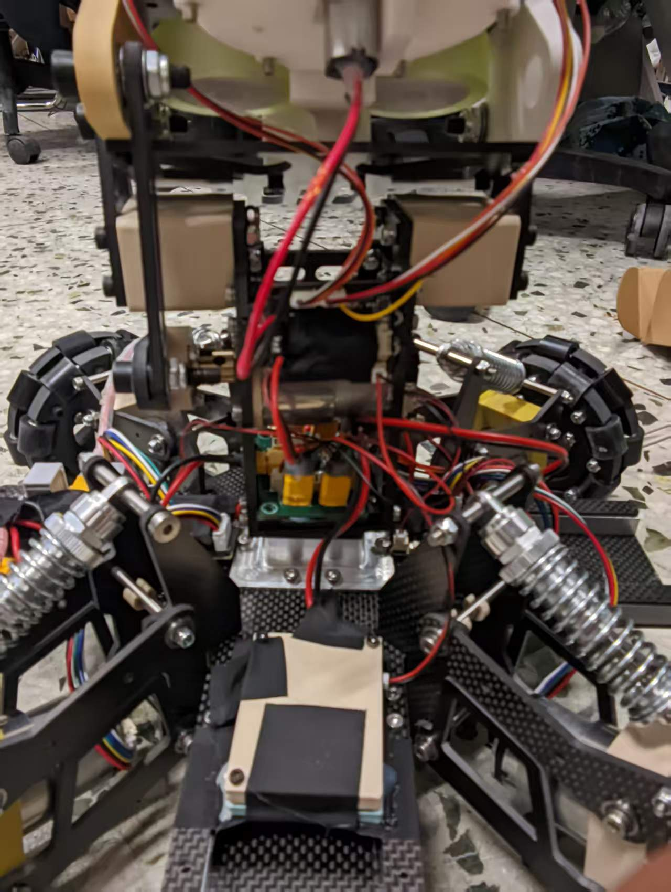
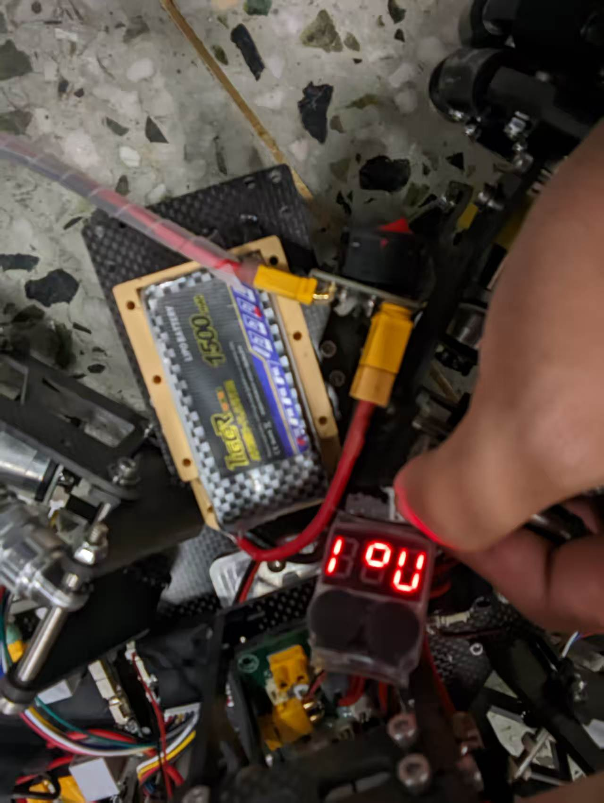
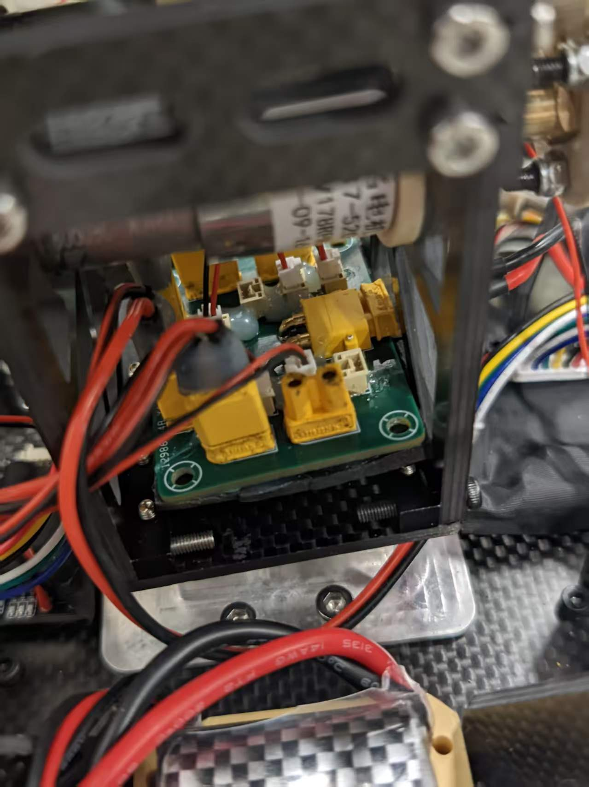

# IntraRM Trial 2026 接线与上车测试说明

本文用于批量装车和烧录前后的接线检查。请先完成断电接线，再进行上电测试。第一次测试时，建议将车轮架空，并让拨弹盘、摩擦轮和云台附近没有人员或异物。

## 一、系统连接关系

整车采用两套连接：

1. **分电板供电**：分电板向每一块 STM32 板提供电源。
2. **分电板 CAN 信号**：所有 STM32 板的 CAN 通过分电板连接到同一条 CAN 总线。

每一块 STM32 板都有：

- 1 个 XT30 电源接口；
- 2 个 CAN 通信接口，两个接口功能相同，接其中一个即可，另一个作为备用口。

需要连接到分电板的 STM32 板包括：

- Main_Board_L431RCT6 主控板；
- Left_Chassis_Motor 左底盘驱动板；
- Right_Chassis_Motor 右底盘驱动板；
- Fric_Feed_Motor_Driver 摩擦轮/拨弹盘驱动板；
- Yaw_Pitch_Motor_Driver 云台 Yaw/Pitch 驱动板。

每块板只使用一个 CAN 口，另一个留作故障排查或备用接线。

### 板子安装位置与车辆方向

本文的前、后、左、右均以车辆自身为准：面向车辆前进方向时，左手侧为车辆左侧，右手侧为车辆右侧。不要把照片画面的左右直接当作车辆左右；从车头面对车辆观察时，左右会相反。

| 安装位置 | 板子或模块 | 安装要求 |
| --- | --- | --- |
| 车辆右侧 | Yaw_Pitch_Motor_Driver、Right_Chassis_Motor | 云台 Yaw/Pitch 驱动板和右底盘驱动板放在右侧 |
| 车辆左侧 | 电源管理模块、Left_Chassis_Motor | 电管和左底盘驱动板放在左侧 |
| 车辆后侧 | Main_Board_L431RCT6 | 主控板放在后侧 |
| 后侧云台上 | Fric_Feed_Motor_Driver | 摩擦轮/拨弹盘驱动板按后侧照片的安装方向粘贴固定 |
| 云台中央 | 分电板 | 按后文顺序接线，车辆正前方保留一个 XT30 口 |

**车辆左侧：电源管理模块与左底盘驱动板位置。**



**车辆右侧：Yaw/Pitch 驱动板与右底盘驱动板位置。**



**车辆后侧：主控板在后侧，摩擦轮/拨弹盘驱动板粘在后侧云台上。**



**车辆前侧参考，用于辨认整车前后方向。**



### 测试通过后的固定与保护

不好固定的板子或部件，在接线和功能测试确认无误后，再使用胶枪粘贴固定。板子先用布基胶带缠绕保护，避免裸露电路接触车架；保留接口和散热部位，不要影响插拔。

固定电池时，**热熔胶只粘用于安装电池的外壳或支架，不要粘在电池本体上**，并确保电池可以正常拆卸、更换。

### 电机与驱动板端口对应关系

底盘驱动板和 Yaw/Pitch 驱动板采用相同的物理编号规则：**靠近 XT30 电源线一侧的电机接口为 2 号位，另一侧为 1 号位。** 这里的 1/2 是同一块板上的电机接口编号，与底盘的 `BOARD_ID=1/2` 不同。

| 驱动板 | 1 号位：远离电源线一侧 | 2 号位：靠近电源线一侧 |
| --- | --- | --- |
| 左底盘驱动板 Left_Chassis_Motor（BOARD_ID=1） | 左前轮电机 | 左后轮电机 |
| 右底盘驱动板 Right_Chassis_Motor（BOARD_ID=2） | 右后轮电机 | 右前轮电机 |
| Yaw/Pitch 驱动板 Yaw_Pitch_Motor_Driver | Pitch 俯仰电机 | Yaw 左右转动电机 |

左右底盘的前后轮接法不对称：左板是“1 左前、2 左后”，右板是“1 右后、2 右前”。按表逐一接线，电机与编码器反馈应对应同一路，不能仅凭哪根线更近来选择接口。

摩擦轮/拨弹盘驱动板按后侧照片所示方向粘好后，**右侧摩擦轮接口接右摩擦轮，左侧摩擦轮接口接左摩擦轮**；左右以安装后的车辆方向为准。拨弹盘电机连接该板的拨弹盘（N20）接口，不接到摩擦轮接口。摩擦轮接口按左右辨认，不套用上表的底盘 1/2 号位规则。

## 二、电源管理模块与分电板

航模电池先经过车辆电源开关，再接到电源管理模块的 XT30 输入端：

```text
航模电池 → 电源开关 → 电源管理模块 XT30 输入
电源管理模块输出 → 分电板输入
分电板 → 各 STM32 板 XT30 电源口
```

电源管理模块有两个输出接口。实际接线时建议使用**中间位置的输出口**，不要优先使用边缘输出口。接线前确认电源管理模块输出电压和极性符合当前车辆硬件要求。

分电板上应在车辆正前方保留一个 XT30 口，不要被主控板、线束或外壳挡住。这个接口用于后续安装图传或其他前方设备。

## 三、推荐接线顺序

分电板安装在机器人云台中央附近时，建议严格按下面顺序操作：

1. **先断开航模电池，确认电源开关处于关闭位置。**
2. 先把每条 CAN 线的一端接到分电板对应的 CAN 接口，另一端暂时不要接各 STM32 板。
3. 将分电板放置并固定在机器人云台中央位置，整理好 CAN 线的走向。
4. 再把 CAN 线另一端接到各 STM32 板。每块板只接一个 CAN 口。
5. 确认分电板正前方预留的 XT30 口没有被线束遮挡。
6. 最后再连接各 STM32 板的 XT30 电源线。
7. 检查所有 XT30 是否插到底、CAN 插头是否锁紧、线束是否不会碰到轮子、摩擦轮、拨弹盘或云台运动部件。
8. 完成目视检查后，才连接电源管理模块输出和电池。

先接 CAN、后放置分电板、最后接 XT30，是为了避免分电板位于云台中央时 XT30 和 CAN 线互相挡住，导致接线困难或拉扯接口。

### 分电板前方预留 XT30 口

下图为分电板车辆前方的接口位置。此处保留一个可用 XT30 口及插拔空间，供后续图传使用，不用其他板子的电源线占用。



## 四、上电前检查清单

逐项确认：

- [ ] 电池经过开关后才进入电源管理模块输入。
- [ ] 每一块 STM32 板都从分电板获得电源。
- [ ] 每一块 STM32 板只连接一个 CAN 口。
- [ ] 所有 CAN 线都接到了分电板，且没有把 CAN 与电源口混插。
- [ ] 分电板正前方的 XT30 口已预留。
- [ ] 左、右底盘板没有装反，板号与固件一致：`Left_Chassis_Motor` 对应 `BOARD_ID=1`，`Right_Chassis_Motor` 对应 `BOARD_ID=2`。
- [ ] 板子已按车辆左右和后侧位置安装；摩擦轮驱动板粘贴方向与后侧照片一致。
- [ ] 电机端口已按对应表接好：靠电源线侧为 2 号，另一侧为 1 号；左右摩擦轮接到安装后对应侧接口。
- [ ] 轮子架空，拨弹盘和摩擦轮附近没有工具、手指或其他异物。
- [ ] 手柄摇杆回中，键盘没有按住运动键，RT 和摩擦轮按键处于松开状态。

## 五、使用 PC_Controller 测试整车

发布包中的电脑程序位于：

```text
Release/PC_Controller_Release/
```

其中包含：

- `RM_PC_Controller_x64.exe`：64 位 Windows，优先使用；
- `RM_PC_Controller.exe`：32 位兼容版本；
- `CH341SER.EXE`：CH340/CH341 驱动安装程序；
- `keybindings.ini`：已配置的按键文件。

### 1. 连接 USB 串口

使用 CH340/CH341 USB 转串口模块连接主控 UART1：

```text
CH340 TXD → 主控 PB7（UART1 RX）
CH340 GND → 主控 GND
```

使用 3.3 V TTL 信号。USB 转串口模块不要向主控额外供电，整车电源由电池、电源管理模块和分电板提供。

如果电脑没有识别出 COM 口，先运行 `CH341SER.EXE` 安装驱动，然后在 Windows 设备管理器的“端口（COM 和 LPT）”中确认出现 USB-SERIAL CH340/CH341。

### 2. 启动程序

1. 先让整车处于安全状态，车轮架空。
2. 打开电源开关，给系统上电。
3. 双击 `RM_PC_Controller_x64.exe`；32 位 Windows 使用 `RM_PC_Controller.exe`。
4. 点击“刷新”，选择对应的 CH340 COM 口。
5. 点击“连接”。
6. 初始状态保持键盘控制关闭，确认手柄仍可正常控制；需要使用键盘时，再点击“启用键盘”。

程序默认每 20 ms 发送一次控制帧。键盘控制获得优先权后，会暂时覆盖手柄输入；按下 Esc、停止键、断开串口或程序超时，键盘控制会停止并把控制权交还给手柄。

### 3. 低风险测试顺序

每一步只操作一个功能，确认正常后再进入下一步：

1. **主控通信**：观察主控是否保持运行，确认没有反复掉线或自动复位。
2. **底盘前后**：短按 `W`，确认车辆前进；短按 `S`，确认车辆后退。
3. **底盘左右平移**：短按 `A`、`D`，确认左右方向正确；若方向相反，立即松键并断电，不要继续提高幅度。
4. **底盘旋转**：短按 `Q`、`E`，确认旋转方向与说明一致。
5. **Pitch**：用方向键上下短促操作，确认 Pitch 每次动作完成后停止。
6. **Yaw**：用方向键左右短促操作，确认 Yaw 按开环方式响应，松开后停止输出。
7. **摩擦轮**：按配置的摩擦轮按键切换一次，确认摩擦轮启动；再次按下确认停止。测试时不要触碰高速摩擦轮。
8. **拨弹盘**：按住配置的开火/RT 按键很短时间，确认拨弹盘方向正确；松开后应停止。

默认键位通常为：`W/S` 前后、`A/D` 左右平移、`Q/E` 底盘旋转、方向键控制云台、空格控制 RT、左 Shift 切换摩擦轮。若 `keybindings.ini` 被修改，以程序当前显示的按键配置为准。

### 4. 测试异常处理

- 电机一上电就转：立即关闭电源开关，检查主控是否掉控、摇杆是否回中、CAN 线和固件是否对应。
- 某个底盘方向相反：立即断电，核对左右底盘文件夹和 CAN 板号，不要交换左右板固件。
- 摩擦轮或拨弹盘方向相反：立即松开按键并断电，核对对应驱动板固件和电机线束。
- 程序显示已发送但车辆没有反应：检查 CH340 的 TXD、GND、COM 口和主控 UART1 接线，再检查主控是否已烧录对应固件。
- 测试过程中任何板子异常发热、异味、噪声或电机失控：立即关闭电源，不要继续尝试。

## 六、烧录文件对应关系

烧录文件在 `Release` 下按板子分文件夹保存。每个文件夹中的 `.elf` 和 `.jdebug` 必须一起保留；用 Ozone 打开同名 `.jdebug` 即可加载同目录 ELF。

| 文件夹 | 板子 | 注意事项 |
| --- | --- | --- |
| `Left_Chassis_Motor` | 左底盘驱动板 | 只能给 CAN `BOARD_ID=1` 的左板烧录 |
| `Right_Chassis_Motor` | 右底盘驱动板 | 只能给 CAN `BOARD_ID=2` 的右板烧录 |
| `Fric_Feed_Motor_Driver` | 摩擦轮/拨弹盘驱动板 | 原工程名为 Gimbal_Motor_Driver |
| `Yaw_Pitch_Motor_Driver` | Yaw/Pitch 驱动板 | Yaw 开环、Pitch 伪闭环 |
| `Main_Board_L431RCT6` | 主控板 | 接收手柄和 PC_Controller 控制 |

一台车完成上述 5 块板的烧录和测试后，再复制同样的 Release 包给下一台车。建议为每台车记录车号、各板烧录时间、操作人员、测试结果和异常情况。
